# Visuals reference

Every layer is drawn by a **generator**, can pass through **effects**, and is placed, coloured and switched on and
off by its **layer settings**. This page explains each one and every parameter. The pictures are rendered from the
demo song (`vizier docs-images` makes them again after a change).

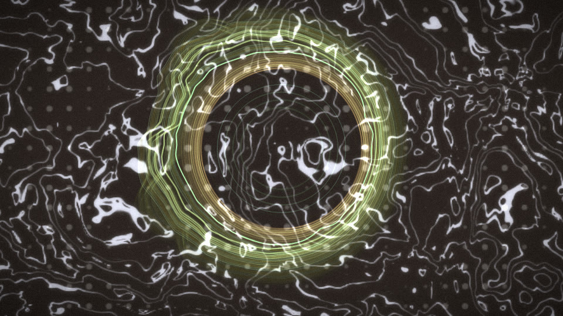
*The demo's full video at bar 20: dot grid, drums flow field (with glow), bass acid ring (with trails), title.*

Parameters can be set in the editor's layer panel, automated (lanes in bars), or driven by the audio
(modulations). Their ranges are the editor's slider ranges; typed values, automation and modulation may go
beyond them.

## What the visuals listen to

Each layer listens to one **track** (a stem, or the mix). Every video frame, vizier measures the track and hands
the generator these **features**. The same names are the sources for modulations (`"source": "bass.centroid"`).
All of them run from 0 to 1.

| Feature | What it measures | Good for |
|---|---|---|
| `rms` | Loudness of this frame | raw level |
| `env` | Loudness, smoothed (fast rise, slower fall) | size, brightness: things that should breathe |
| `low` | Energy at 20–150 Hz | kick and sub weight |
| `lowMid` | 150–600 Hz | bass body, toms |
| `mid` | 600 Hz – 3 kHz | vocals, leads |
| `high` | 3–16 kHz | hats, air, noise |
| `centroid` | Where the sound's brightness sits, 50 Hz (0) to 10 kHz (1) | a 303's filter sweep; vocals opening up |
| `flux` | How much the sound is changing | busy versus sustained passages |
| `onset` | 1 on the frame a hit starts, otherwise 0 | flashes, stutters |
| `hit` | 1 at a hit, fading out over about 0.3 s | kicks that should push something and let go |
| spectrum | 32 bands from low to high (generators only) | shapes that trace the sound |

Features are *causal*: a frame only knows the audio up to that moment, so offline renders and the live window
react identically.

## Generators

### Acid ring (`acidRing`)

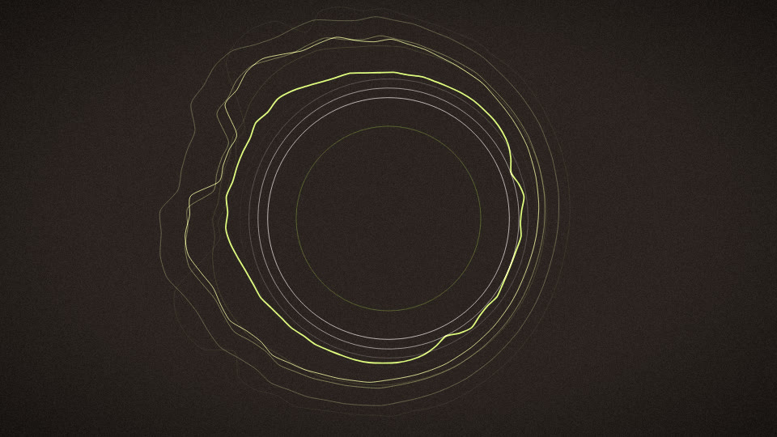

A closed ring traced by the track's spectrum, with fading echoes of the last few moments drawn around it. Built
for a 303: the line turns towards the highlight colour as the filter opens. Louder passages swell the ring, the
spectrum pushes spikes out of it, and each hit flashes a thin circle inside.

Listens to: spectrum (the ring's shape), `env` (size), `centroid` (colour), `onset` (inner flash).
Colours: **Line** (`line`, default: ink), **Highlight (open filter)** (`highlight`, default: accent).

| Parameter | Range (default) | What it does |
|---|---|---|
| Radius (`radius`) | 0.2–2 (1) | Size of the ring. 1 is about a fifth of the layer's shorter side; loudness adds up to a third more. |
| Spectrum spikes (`spike`) | 0–1 (0.3) | How far the spectrum pushes the line outward. 0 is a smooth circle that only breathes. |
| Spin (`spin`) | −1–1 turns/s (0.05) | Rotation speed; positive turns clockwise. |
| Highlight amount (`acid`) | 0–2 (1) | How strongly the line moves to the highlight colour as the sound gets brighter. 0 keeps it the line colour. |
| Echoes (`echoes`) | 0–30 (10) | How many fading copies of earlier moments are drawn behind the current ring, each a little larger. |
| Echo spacing (`echoSpacing`) | 1–10 frames (2) | Time between echoes. Larger reaches further back, so the echoes differ more. |
| Line width (`lineWidth`) | 0.5–10 (2) | Line thickness (in pixels at 1080p; scales with the layer). The current ring is drawn thicker. |

### Pulse grid (`pulseGrid`)

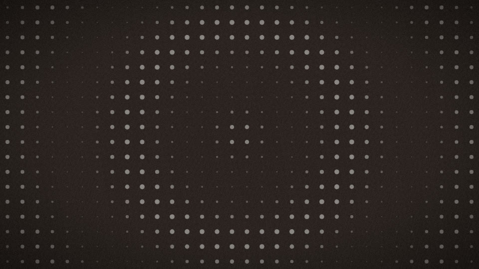

A halftone field of dots. The dots grow with the low end, ripples run out from the centre, and every hit flashes
the dots, strongest in the middle.

Listens to: `low` (dot size), `env` (brightness), `onset` (flash).
Colour: **Dots** (`dots`, default: ink).

| Parameter | Range (default) | What it does |
|---|---|---|
| Density (`density`) | 4–60 dots (18) | How many dots fit across the layer's shorter side. |
| Brightness (`brightness`) | 0–2 (1) | Overall brightness of the dots. |
| Ripple speed (`wave`) | 0–4 (1) | How fast the rings of large and small dots travel outward. 0 freezes the pattern (it still pulses). |

### Flow field (`flowField`)

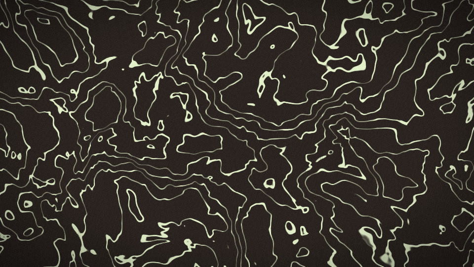

Contour lines of a slowly drifting, folded noise field, drawn on the GPU (cheap at any size). Hits distort the
flow and flash the lines; hats make the lines thicker.

Listens to: `env` (brightness), `hit` (distortion and flash), `high` (line thickness), `centroid` (colour).
Colours: **Lines** (`line`, default: ink), **Highlight** (`highlight`, default: accent).

| Parameter | Range (default) | What it does |
|---|---|---|
| Scale (`scale`) | 0.5–8 (2.5) | Zoom of the pattern: larger values give more, smaller swirls. |
| Drift speed (`speed`) | 0–2 (0.2) | How fast the field drifts and evolves. |
| Lines (`density`) | 2–40 (14) | How many contour lines: more lines, closer together. |
| Warp (`warp`) | 0–3 (1.2) | How much the field is folded over itself: 0 is gentle hills, higher is marbled. |
| Line thickness (`thickness`) | 0.01–0.5 (0.08) | Thickness of the lines (hats add to it). |
| Brightness (`brightness`) | 0–3 (1) | Overall brightness. Quiet passages are dim; loudness and hits brighten. |
| Hit response (`kick`) | 0–3 (1) | How strongly hits distort the flow and flash the lines. 0 ignores hits. |
| Highlight amount (`acid`) | 0–1 (0.3) | How much the lines take the highlight colour, more when the sound is brighter. |

### Ridgeline (`ridgeline`)

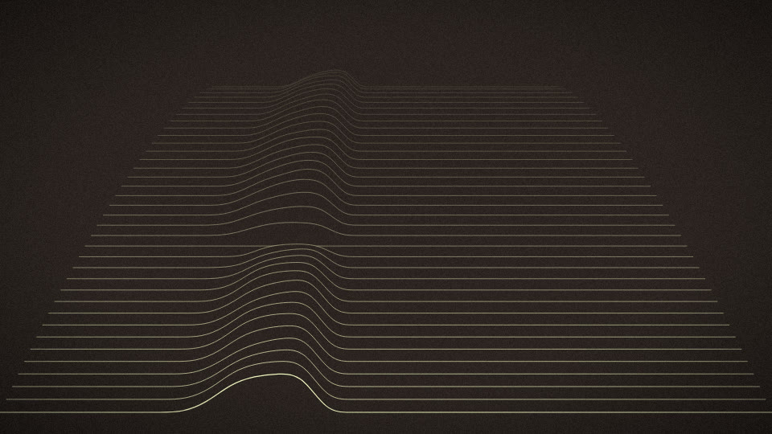

The "Joy Division" picture: the track's recent spectra as stacked lines, the newest at the front and older ones
receding towards the horizon. Each ridge can be filled to hide the ones behind it.

Listens to: spectrum history (the ridges), `centroid` (colour, per ridge).
Colours: **Lines** (`line`, default: ink), **Highlight (bright)** (`highlight`, default: accent: ridges of bright moments, such as vocals, when Highlight amount is up),
**Fill under ridges** (`fill`, default: bg).

| Parameter | Range (default) | What it does |
|---|---|---|
| Rows (`rows`) | 4–80 (36) | How many ridges. |
| Frames between rows (`spacing`) | 1–8 (2) | Time between ridges: larger shows a longer stretch of history. |
| Ridge height (`height`) | 0–2 (0.8) | How tall the peaks rise. |
| Ignore below (`floor`) | 0–0.9 (0.35) | Spectrum levels below this stay flat, so only real peaks rise (raise it for noisy stems). |
| Perspective (`depth`) | 0–0.9 (0.55) | How much the far ridges narrow: 0 is flat, higher is a deeper view. |
| Line width (`lineWidth`) | 0.5–6 (1.5) | Line thickness (pixels at 1080p); the front ridge is thicker. |
| Hide lines behind (`fill`) | on/off (on) | Fill under each ridge with the fill colour, hiding the ridges behind it. Off gives see-through wireframes. |
| Highlight amount (`acid`) | 0–2 (0) | How strongly ridges take the highlight colour when that moment was bright. |

### Text (`typeText`)

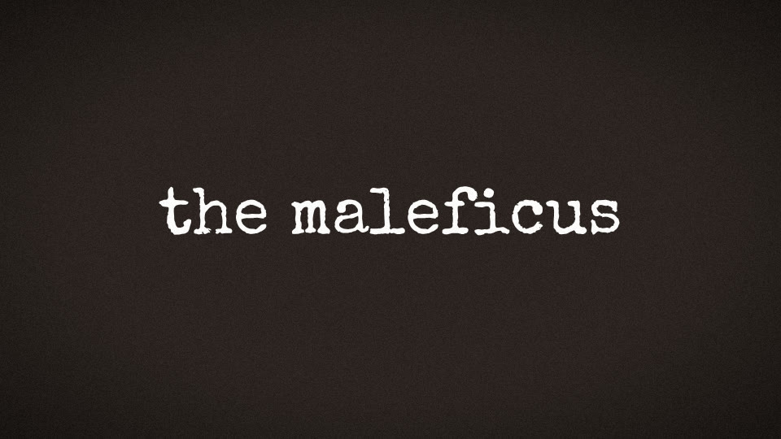

The layer's text in Special Elite: a title, a caption or a text card. Lines break where the text has a Return, and
can also wrap to fit the box; they can sit left, centred or right, and shrink to fit. It can be typed out letter by
letter (with a blinking caret), shaken, sliced into glitchy strips, and blurred. The layer's size and position set
where it goes; the text is set in the layer panel.

With **Panel** above 0 a filled, rounded panel the size of the layer's box sits behind the text. **+ Add layer… →
Text card** adds a Text layer set up as a card: the background colour at 70% behind wrapped, centred lines that
shrink to fit, in a box in the middle of the frame.

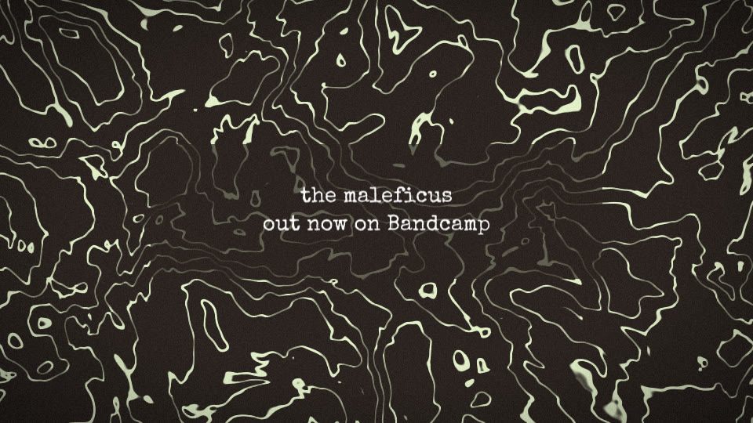

Listens to: `onset` (stutter strips appear on hits).
Colours: **Text** (`text`, default: ink), **Panel** (`panel`, default: bg).

| Parameter | Range (default) | What it does |
|---|---|---|
| Size (`size`) | 0.05–1 (0.35) | Letter height as a share of the layer's height. Make the layer wider than the text needs. |
| Typed (`reveal`) | 0–1 (1) | How much of the text is shown: automate 0 → 1 to type it out. A caret blinks while typing. |
| Shake (`shake`) | 0–3 (0) | Random jitter of the whole text, every frame (the same in every render). |
| Stutter (`stutter`) | 0–2 (0) | Glitch: horizontal strips of the text slide sideways on hits, and sometimes in between. |
| Blur (`blur`) | 0–20 (0) | Softens the letters; automate it down to bring text into focus. |
| Align (`align`) | 0–2 (1) | Where lines sit across the box: 0 left, 1 centred, 2 right (inside the padding). |
| Wrap (`wrap`) | on/off (off) | Break long lines at spaces to fit the box's width. Off: each line (Return in the text) stays one line. |
| Shrink to fit (`fit`) | on/off (off) | Make the letters smaller, if needed, so all the text fits inside the box (and its padding). |
| Line spacing (`lineSpacing`) | 0.8–2.5 (1.2) | Distance from one line to the next, in letter heights. |
| Panel (`panel`) | 0–1 (0) | A filled panel behind the text, the size of the layer's box: its opacity. 0: no panel. |
| Padding (`padding`) | 0–0.4 (0.06) | Space between the box's edge and the text, as a share of the box's shorter side. |
| Panel corners (`corner`) | 0–0.5 (0.05) | How rounded the panel's corners are, as a share of the box's shorter side. 0: square. |

### Laser fan (`lasers`)

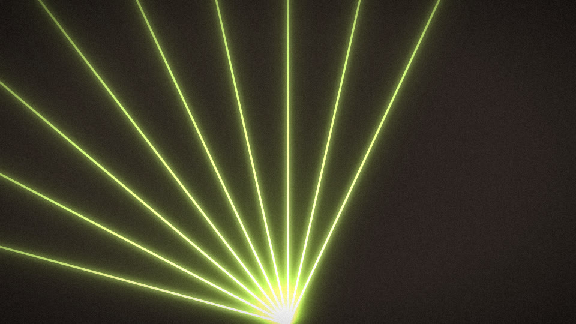

A fan of laser beams from one point, like a rig over a dance floor, drawn on the GPU. The fan sweeps from side to
side in time with the beat (set by the song's tempo, so it stays locked to the music); loudness lights the beams
and hits strobe them. Add Glow for the haze of a smoky room, and set the blend to add.

Listens to: `env` (brightness), `hit` (strobe), and the beat (the sweep).
Colours: **Beams** (`beam`, default: accent), **Core (hot centre)** (`core`, default: ink).

| Parameter | Range (default) | What it does |
|---|---|---|
| Beams (`beams`) | 1–32 (9) | How many beams in the fan. |
| Spread (degrees) (`spread`) | 0–180 (100) | The angle the fan covers, from the first beam to the last. |
| Sweep (degrees) (`sweep`) | 0–90 (25) | How far the whole fan swings either way, in time with the beat. |
| Beats per sweep (`beatsPerSweep`) | 1–32 (4) | How many beats one swing (one way) takes: 4 is a bar in 4/4. Change it with a hold step: a gradual change makes the fan jump. |
| Scissor (`scissor`) | on/off (off) | Every other beam swings the opposite way, so the beams cross like scissors. |
| Origin height (`origin`) | −0.5–1.5 (0) | Where the beams start: 0 the bottom of the layer, 1 the top (and beyond, off the edge). |
| Beam width (`width`) | 0.001–0.03 (0.004) | Thickness of a beam, as a share of the layer's height. |
| Haze (`haze`) | 0–2 (0.6) | A soft glow around each beam, as if through smoke. |
| Falloff (`falloff`) | 0–4 (0.8) | How quickly beams fade with distance from where they start. |
| Brightness (`brightness`) | 0–3 (1) | Overall brightness. Quiet passages are dim; loudness lights the beams. |
| Hit strobe (`strobe`) | 0–3 (1) | How much hits flash the beams. 0 ignores hits. |

### Tunnel (`tunnel`)

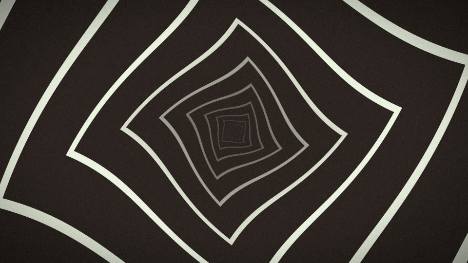

An endless tunnel of rings rushing towards you, a ring per beat (or as many as you set), drawn on the GPU. The
rings can be round or have corners; twist turns them into a spiral. The low end (kick and sub) widens the rings;
hits flash them in the highlight colour. The far end fades into the dark.

Listens to: `env` (brightness), `low` (ring width), `hit` (flash), and the beat (movement and spin).
Colours: **Rings** (`line`, default: ink), **Highlight (hits)** (`highlight`, default: accent).

| Parameter | Range (default) | What it does |
|---|---|---|
| Sides (`sides`) | 0–8 (4) | The rings' shape: 0 round, 3 triangles, 4 squares, 6 hexagons… |
| Rings per beat (`ringsPerBeat`) | 0–4 (1) | Rings passing you per beat (0 stands still). Change it at a bar with a hold step: a gradual change makes the tunnel jump. |
| Depth spacing (`density`) | 0.5–8 (2.5) | How close together the rings are: more rings fit in the view. |
| Twist (`twist`) | −3–3 (0.4) | How much the rings turn with depth, making a spiral. |
| Spin (turns/bar) (`spin`) | −2–2 (0.05) | How fast the tunnel turns, in turns per 4 beats. Change it with a hold step: a gradual change makes it jump. |
| Line width (`width`) | 0.01–0.5 (0.08) | Thickness of the rings, as a share of the space between them. |
| Low-end pump (`pump`) | 0–2 (0.6) | How much the kick and sub widen the rings. 0 ignores the low end. |
| Brightness (`brightness`) | 0–3 (1) | Overall brightness. The far end fades into the dark. |
| Hit flash (`flash`) | 0–3 (1) | How much hits light the rings in the highlight colour. 0 ignores hits. |

### Truchet maze (`truchet`)

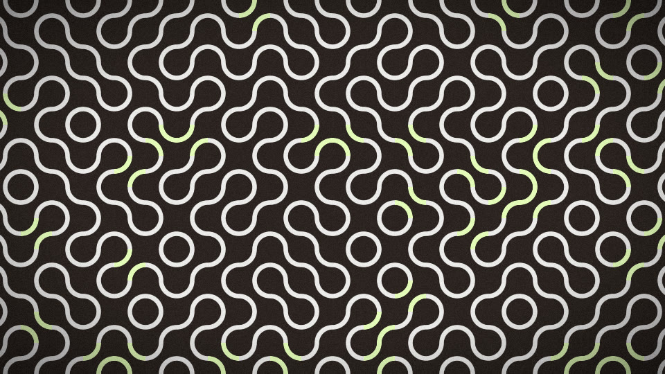

A maze of curved tiles (Truchet tiles: each holds two quarter circles, so the curves join into endless paths).
Every few beats some tiles turn, rewiring the paths, and light up in the highlight colour as they do. Drawn on
the GPU.

Listens to: `env` (brightness), `hit` (flash), and the beat (when tiles turn).
Colours: **Paths** (`line`, default: ink), **Highlight (just turned)** (`highlight`, default: accent).

| Parameter | Range (default) | What it does |
|---|---|---|
| Tiles (`tiles`) | 2–60 (12) | How many tiles fit across the layer's shorter side. |
| Beats per change (`beatsPerChange`) | 0.25–16 (1) | How often tiles turn: every this many beats. |
| Tiles changing (`change`) | 0–1 (0.15) | The share of tiles that turn at each change. |
| Line width (`width`) | 0.02–0.5 (0.12) | Thickness of the paths, as a share of a tile. |
| Turn glow (beats) (`glow`) | 0–8 (1.5) | How long a tile stays lit after it turns, in beats. 0: no highlight. |
| Brightness (`brightness`) | 0–3 (1) | Overall brightness. Quiet passages are dim; loudness and hits brighten. |
| Hit flash (`flash`) | 0–3 (0.6) | How much hits brighten the whole maze. 0 ignores hits. |

## Effects

A layer's effects run in order on its picture, before it's composited with the others.

### Glow (`glow`)

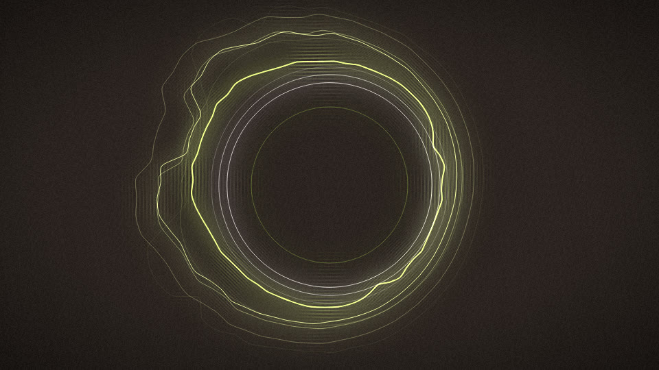

A soft halo around the bright parts of the layer: a blurred copy added back on top.

| Parameter | Range (default) | What it does |
|---|---|---|
| Amount (`amount`) | 0–3 (1) | Strength of the halo. |
| Radius (`radius`) | 1–40 pixels (8) | How far the halo spreads, in pixels of the full-size video (a smaller preview scales it to match). |

### Trails (`trails`)

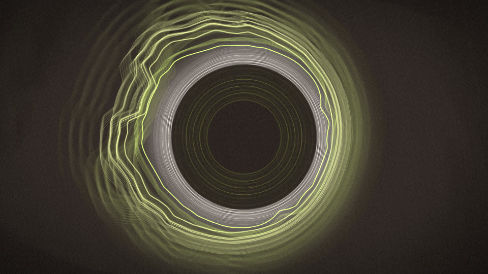

Leaves fading copies of the layer behind it. Each frame is drawn over a faded copy of the previous one; with zoom
and rotation the copies drift outward and turn, making tunnels and spirals. Times are in seconds, so trails look
the same at 30 fps (video) and 60 fps (live). Trails start fresh when a layer comes on (see "When it's on") or is
resized.

| Parameter | Range (default) | What it does |
|---|---|---|
| Persistence (`persistence`) | 0.05–3 s (0.6) | How long a trail takes to fade (to a tenth). |
| Zoom per second (`zoom`) | 0.5–2 (1) | Above 1, trails grow outward (a tunnel); below 1, they shrink inward. |
| Rotate (`rotate`) | −90–90 °/s (0) | Trails turn as they fade, making spirals; negative values turn the other way. |

### RGB split (`rgbSplit`)

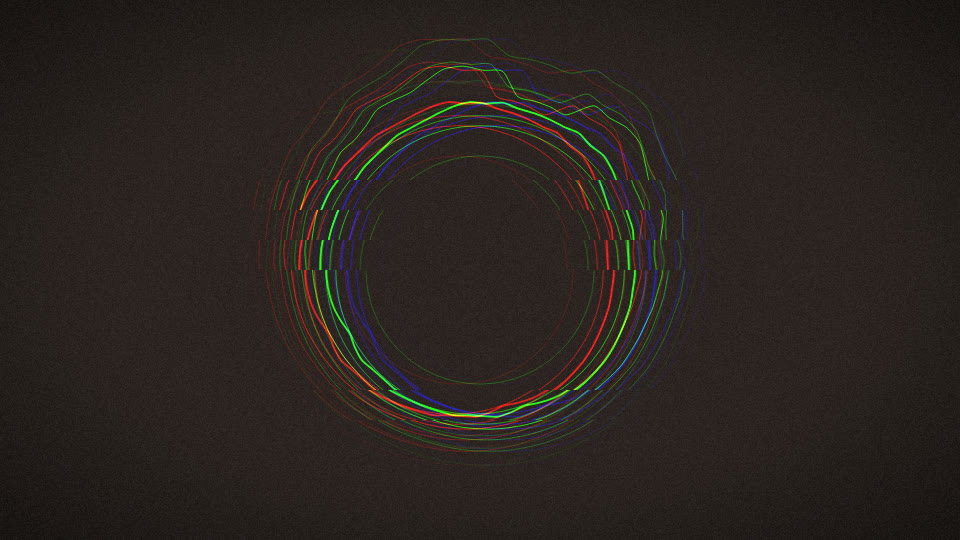

Chromatic aberration and glitch: the red and blue of the layer pulled apart sideways (always a little, more on a
hit), and on hits, horizontal strips of the picture jump sideways for a few frames. It listens to the layer's own
track.

| Parameter | Range (default) | What it does |
|---|---|---|
| Split (pixels) (`offset`) | 0–40 (4) | How far red and blue sit from green, in pixels of the full-size video, all the time. |
| Hit split (pixels) (`kick`) | 0–80 (16) | How much further they move apart on a hit (fading with it). |
| Glitch (`glitch`) | 0–1 (0.3) | On hits, how many horizontal strips jump sideways. 0: none. |
| Strips (`strips`) | 2–64 (18) | How many strips the picture is cut into for the glitch. |

### Kaleidoscope (`kaleidoscope`)

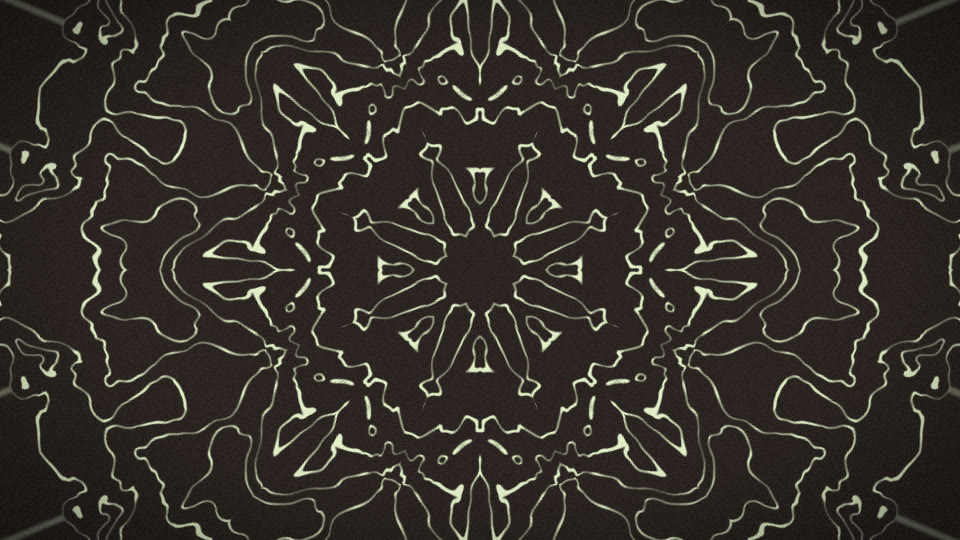

Mirrors the layer into wedges around its centre, like a kaleidoscope; it can turn in time with the beat. Put it
on a layer with movement (a flow field, trails) for mandalas that keep changing.

| Parameter | Range (default) | What it does |
|---|---|---|
| Segments (`segments`) | 2–16 (6) | How many mirrored wedges make the circle. |
| Angle (degrees) (`angle`) | −180–180 (0) | Turns the pattern: which part of the layer the wedges show. |
| Spin (turns/bar) (`spin`) | −2–2 (0) | How fast it turns, in turns per 4 beats (0 stands still). Change it with a hold step: a gradual change makes it jump. |
| Zoom (`zoom`) | 0.25–4 (1) | Above 1, the wedges show a smaller, closer part of the layer. |

## Layer settings

These belong to every layer, whatever draws it.

- **Track**: which stem the layer listens to (default: the mix).
- **Blend**: how the layer combines with what's behind it (the layers below it, and the background colour under them all).
  - **normal**: on top, covering what's behind where it's opaque.
  - **add**: brightens what's behind (light adds up; good for glowing lines).
  - **screen**: brightens too, more gently, never past white.
  - **multiply**: darkens what's behind (shadows, tinting).
- **Order**: the layer list goes front to back; the top layer is drawn last, over the others.
- **Layout**: position and size as fractions of the frame, and rotation in degrees (counter-clockwise), one
  layout per shape of format (landscape, portrait, feed). Drag on the preview or type in the panel.
- **When it's on** (`spans`): bars where the layer is drawn, with fades in beats (see [projects.md](projects.md)).
- **Colours**: each generator colour follows a palette slot unless the layer sets its own (in the video file for
  now; colour pickers come in editor milestone 5).
- **Resolution scale** (`resolutionScale`, in the file): draws the layer at a fraction of its size, then scales it
  up. Cheap and soft, good for backgrounds (the demo's dot grid uses 0.5).

| Parameter | Range (default) | What it does |
|---|---|---|
| Opacity (`opacity`) | 0–1 (1) | How visible the layer is. |
| Hue shift (`hueShift`) | −180–180° (0) | Rotates all the layer's colours around the colour wheel (keeps brightness). |
| Lightness (`lightness`) | −1–1 (0) | Pushes all the layer's colours towards black (−1) or white (+1). |
| Soft edge (`softEdge`) | 0–0.5 (0) | Fades the layer out towards the edges of its box (a fraction of its shorter side), so trails or glow that reach the box don't end in a straight line. Try 0.15–0.25. |
| X, Y (`x`, `y`) | 0–1 (layout) | Centre position. As parameters they override the layout, for automating movement. |
| Width, Height (`w`, `h`) | 0–2 (layout) | Size, likewise for automation. |
| Rotation (`rotation`) | −180–180° (layout) | Rotation, likewise for automation. |

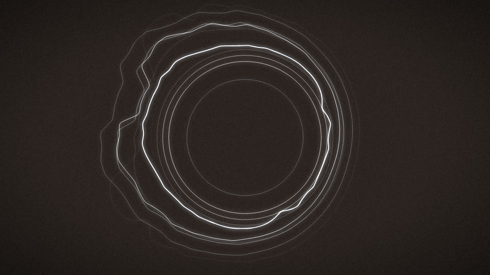
*Hue shift 120° on the acid ring: the green highlight turns blue, the line keeps its brightness. Let audio drive it
(`{ "target": "ring.hueShift", "source": "bass.centroid", "amount": 60 }`) to swing the colours with the filter.*

## Whole picture

Applied after all layers, automatable as `post.<name>`:

| Parameter | Range (default) | What it does |
|---|---|---|
| Film grain (`grain`) | 0–0.3 (0.05) | Fine moving noise over the picture, one speck per pixel, the same in every render. A smaller preview shows it fainter. |
| Vignette (`vignette`) | 0–1 (0.55) | Darkens the corners. |

The palette's **bg** colour is the background behind every layer.

## Adding your own

See [adding-a-generator.md](adding-a-generator.md). Declare parameters with a label, range and default, and they
appear in the editor, can be automated, and are checked by `vizier validate`. Add your generator to this page (a
test checks every generator, effect and parameter is mentioned here) and to `scripts/make-docs-images.ts`.
